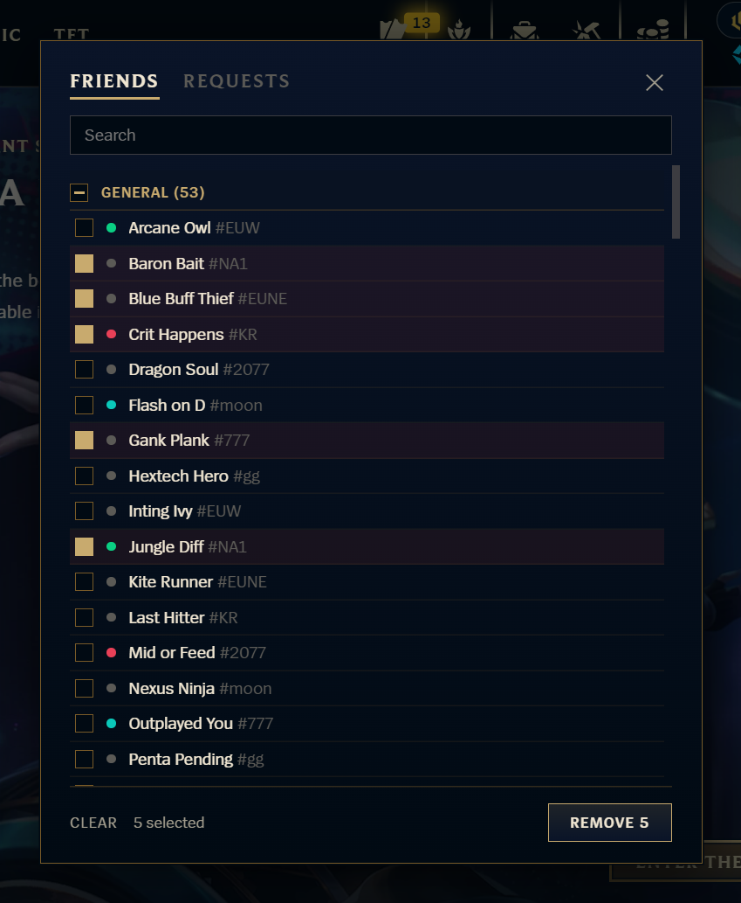

The client only lets you remove friends one at a time. Friend Cleaner adds a button to the social panel so you can tick as many as you want and remove them in one go. It does the same for friend requests.

## Features
- New button in the social panel's top bar, next to the add friend and folder buttons
- Friends grouped by folder, with a checkbox per friend and per folder
- Shift-click to select a range, search by name, tag or note
- Requests tab: decline incoming friend requests or cancel the ones you sent
- Asks you to confirm before anything is removed, and shows progress per friend

Discord contacts that aren't League friends are not listed, since they can't be removed from the client.

## Install
1. Download the latest release from this post
2. Extract the `friend-cleaner` folder into your Pengu Loader `plugins` folder (press Ctrl+K in the client and pick "Open plugins folder")
3. Restart the League client

## Usage
Click the person icon with a minus sign in the social panel's top bar, or press **Ctrl+K** and pick **Remove friends** or **Decline friend requests**.

- Tick the friends or requests you want gone. Click a folder name to tick everyone in it.
- Click **Remove** (or **Decline**), then click again to confirm.
- Removed rows get crossed out. Any that failed turn red.

Removing a friend can't be undone from here. You'd have to send them a new friend request.

## Support
Questions or bugs: reply in this thread or open an issue on GitHub.
