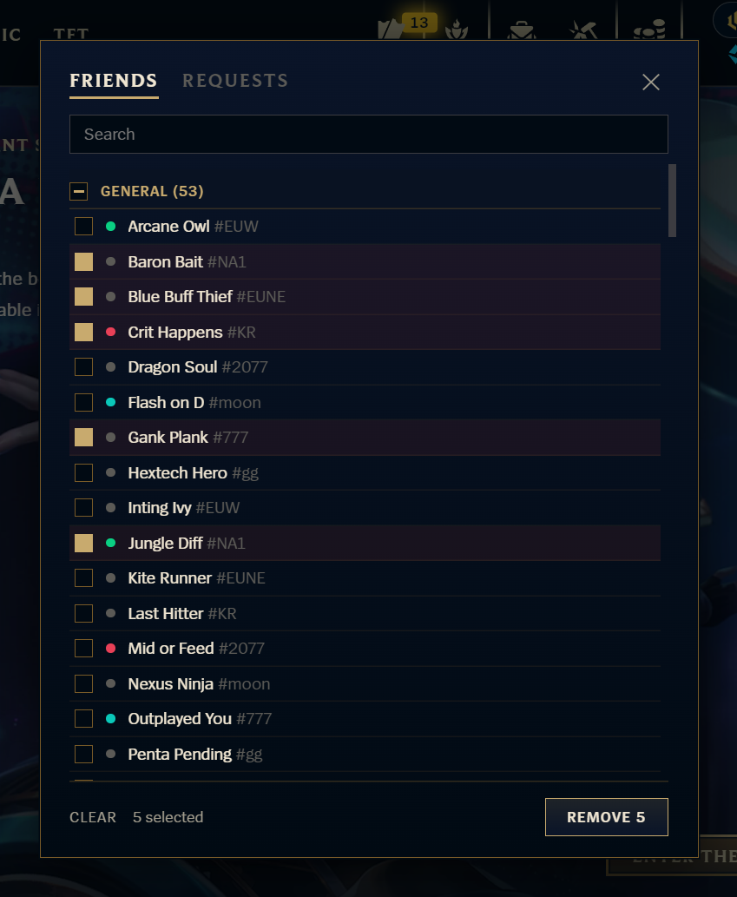

# Friend Cleaner

A [Pengu Loader](https://pengu.lol) plugin that lets you remove many League friends, or decline many friend requests, at once. The client normally only does this one person at a time.

## Features

- A new button in the social panel, next to the add friend and folder buttons
- Friends grouped by folder, with a checkbox per friend and per folder
- Shift-click to select a range, search by name, tag or note
- Requests tab to decline incoming friend requests or cancel the ones you sent
- Asks you to confirm before anything is removed, and shows progress per friend

Discord contacts that aren't League friends are not listed, since they can't be removed from the client.

## Install

1. Download `friend-cleaner.zip` from the [latest release](../../releases/latest).
2. Extract the `friend-cleaner` folder into your Pengu Loader `plugins` folder. You can open it by pressing Ctrl+K in the client and picking "Open plugins folder".
3. Restart the League client.

## Usage

Click the person icon with a minus sign in the social panel's top bar, or press **Ctrl+K** and pick **Remove friends** or **Decline friend requests**.

- Tick the friends or requests you want gone. Click a folder name to tick everyone in it.
- Click **Remove** (or **Decline**), then click again to confirm.
- Removed rows get crossed out. Any that failed turn red.

Removing a friend can't be undone from here. You'd have to send them a new friend request.

## Uninstall

Delete the `friend-cleaner` folder from your plugins folder and restart the client.

## License

[MIT](LICENSE)
